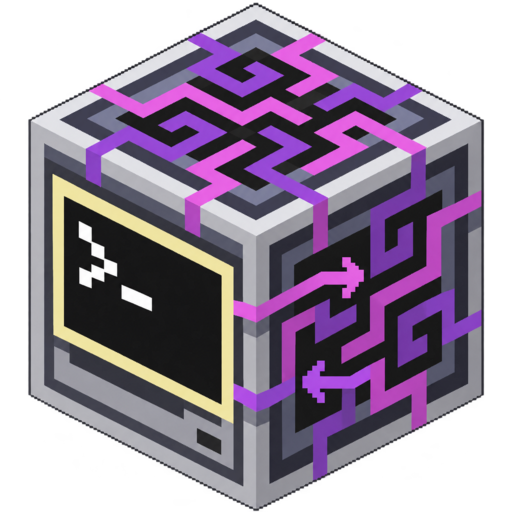
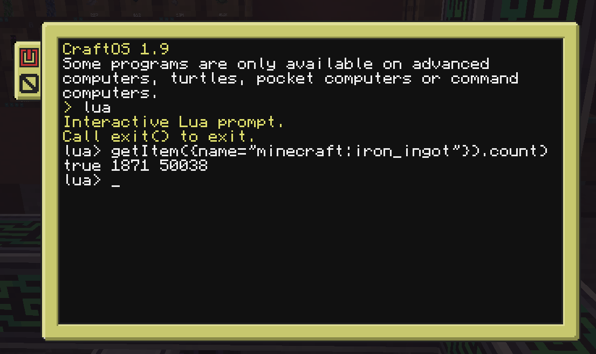

<p align="center"></p>

# Applied ComputerCraft

A small NeoForge mod for Minecraft 26.1.2 that lets CC:Tweaked computers read and drive an Applied Energistics 2 network.

There are no new blocks. It adds a CC peripheral to every AE2 block that hosts a grid node (controller, interface, drive, energy acceptor, cable). Put a computer or wired modem against one and use `peripheral.find("me_bridge")`:

```lua
local me = peripheral.find("me_bridge")
print(me.getItem({name = "minecraft:diamond"}).count)
```



It only needs to be installed where the game logic runs: on a dedicated server, or in the client for singleplayer. It adds nothing to registries or the network protocol, so players can join a server that has it without installing it themselves.

## Requirements

- Minecraft 26.1.2, NeoForge 26.1.2.94 or newer
- Applied Energistics 2 26.1.10-beta or newer
- CC:Tweaked 1.118.0 or newer

The AE block the computer touches must be powered and active.

## Filters

Most methods take a filter: a string id, or a table with any of these fields.

| Field | Meaning |
|---|---|
| `name = "minecraft:iron_ingot"` | exact id |
| `name = "#c:ingots"` | item or fluid tag |
| `displayName = "iron"` | case-insensitive substring of the display name |
| `keyType = "appflux:flux"` | exact AE2 key type id, as reported in the `keyType` field of an entry |
| `type = "item"` / `"fluid"` / a key type id | same idea as `keyType`, with `"item"` and `"fluid"` as short names. `type = "ae2:i"` also matches items, and `"ae2:f"` fluids. Unknown values match nothing |
| `count = 64` (or `amount`) | how many to move or craft. Defaults to 64 for items and 1000 mB for fluids |

`keyType` and `type` only narrow a search. Methods that move, craft or cancel (and `getItem`, `getFluid`, `isCrafting` and the `isCraftable` family) still need a `name`, a tag or a `displayName`, and `cancelCraftingTasks` needs one of those or `{all = true}`. Only `getResources` and `getResource` accept a `keyType` or `type` on its own.

Data components are not matched. A name matches every variant of that id, and the first one found is used.

## Methods

Methods that fail return `nil` (or `0` / `false`) plus a status string, such as `NOT_CONNECTED`, `NOT_FOUND`, `NOT_CRAFTABLE` or `INVENTORY_NOT_FOUND`.

**Status**
- `isConnected()`: true when the bridge can use the network.
- `isOnline()`

**Listing**
- `getItems([filter])` / `listItems`, `getFluids([filter])` / `listFluids`
- `getResources([filter])` / `listResources`: every stored key of every AE2 key type, not just items and fluids. This is how you see add-on key types such as Applied Flux's FE. It walks the network inventory once, like `getItems`.
- `getItem(filter)`, `getFluid(filter)`, `getResource(filter)`: one entry, or the craftable entry with count 0 if none is stored. `getResource` accepts any key type.
- `getCraftableItems([filter])`, `getCraftableFluids([filter])`

Each entry is a table with `name`, `displayName`, `count`, `amount`, `isCraftable`, `type`, `keyType`, `amountPerUnit` and, when the key type has one, `unit`. Items also have `maxStackSize` and `hasComponents`.
- `type` is `"item"`, `"fluid"`, or the key type id for anything else.
- `keyType` is the AE2 key type id, such as `"ae2:i"` (items) or `"ae2:f"` (fluids).
- `unit` is the key type's unit symbol (`"B"` for fluids). Items have none, so the field is absent.
- `amountPerUnit` is how many base units make one `unit`: 1000 for fluids, 1 for items.
- `count` and `amount` are raw base units (mB for fluids). Divide by `amountPerUnit` to get `unit`s, for example buckets.
- `keyType`, `unit` and `amountPerUnit` also appear on `getItems`, `getFluids` and the other methods that return entries.
- Lua numbers are doubles, so counts above 2^53 (about 9e15) lose precision.

Reading Applied Flux's FE, which it stores in the network as its own key type. The key type is `appflux:flux` and the key itself is `appflux:fe` (confirmed on a live network):

```lua
local fe = me.getResource({keyType = "appflux:flux"})
if fe then print(fe.displayName, fe.count) end
```

Applied Replicatics' matter shows up the same way, as `keyType` `apprep:m`. For any other add-on, call `me.getResources()` and look at the `keyType` field of its entries.

**Crafting**
- `isCraftable(filter)`, `isItemCraftable(filter)`, `isFluidCraftable(filter)`
- `isCrafting(filter)`
- `craftItem(filter [, cpuName])` and `craftFluid(filter [, cpuName])` return a job id.
  - When AE2 has worked out the crafting plan, the computer gets one event, `me_crafting`, with `id, ok, name, amount, message`.
  - `message` is one of: `STARTED`, `CANCELLED`, `NOT_CONNECTED`, `MISSING_INGREDIENTS: 4xminecraft:iron_ingot ...`, an AE2 error such as `CPU_BUSY` or `NO_CPU_FOUND`, or `ERROR: ...`.
  - `STARTED` means the job was handed to a crafting CPU, not that the items are finished. Use `isCrafting` to see when it is done.
  - CC drops events that arrive while a script is waiting on a peripheral call, so a script that fires several `craftItem` calls in a row can miss some `me_crafting` events. To be safe, check with `isCrafting` or `getCraftingTasks`.
  - Each computer can have 8 requests calculating at once by default. Past that the call returns `nil, "TOO_MANY_JOBS"`.
- `getCraftingCPUs()`, `getCraftingTasks()`. A CPU without a name is reported as `CPU #n`, where n is its 1-based position in the network's CPU list. This is the same format AE2's screen uses, but the position is not stable: it can change after a restart or when a CPU is built, removed or goes inactive. Name your CPUs in AE2 to target one reliably.
  - The `cpuName` argument of `craftItem` and `craftFluid` takes a CPU's name or that `CPU #n` label. A CPU that is literally named `CPU #3` is preferred over the unnamed CPU in position 3.
  - `"Unnamed"` is still accepted as `cpuName` and means the first unnamed CPU. It is deprecated and no longer reported anywhere.
- `cancelCraftingTasks(filter)`: cancels running jobs for that resource, and this computer's requests that are still calculating. A filter is required. Pass `{all = true}` to cancel every job on the network.

**Energy**
- `getStoredEnergy()`, `getEnergyCapacity()`, `getEnergyUsage()`, `getAverageEnergyInput()`, `getEnergyInfo()`. These also work when the network is out of power.

**Moving items and fluids**
- `exportItem(filter, target)`, `exportFluid(filter, target)`, `importItem(filter, target)`, `importFluid(filter, target)` return the amount moved.
- `target` is either:
  - a direction from the AE block: `"up"` or `"top"`, `"down"` or `"bottom"`, `"north"`, `"south"`, `"east"`, `"west"`
  - the name of a peripheral the computer can see, such as `"left"` or `"minecraft:chest_0"`
- For import, `{}` means anything.
- If a storage bus on the same network watches the target inventory, the items just go around in a loop. The amount returned counts them anyway, even though nothing really moved.

## Coming from Advanced Peripherals

The Lua API is modelled on Advanced Peripherals' ME Bridge, and method names and argument order match where the two overlap. Porting a script is usually a small edit, but it isn't a drop-in replacement:

- The crafting event is `me_crafting` (AP uses `ae_crafting`). `craftItem` returns a number, not a job object.
- `getResources` and `getResource` have no Advanced Peripherals counterpart.
- Unnamed crafting CPUs are reported as `CPU #n` here, where AP reports `Unnamed`.
- AP filters accept `type = "chemical"` and error on unknown types. Here `type` is `"item"`, `"fluid"` or a key type id (for example the id of a chemical add-on's key type), and unknown values just match nothing.
- There are no `fingerprint` or `components` filters, and entries have no `tags`, `fingerprint` or `components` fields.
- Not implemented:
  - the storage capacity methods (`getTotalItemStorage` and friends)
  - `getCells`, `getDrives`, `getPatterns`, `getCraftingTask(id)`
  - chemicals as their own methods (use `getResources` to list them, though `craftItem` and the export and import methods still only handle items and fluids)
- Export and import targets don't accept `front`, `back`, `left` or `right` as directions. AE2 blocks have no facing, so use a compass direction or a peripheral name instead.

This mod shares no code with Advanced Peripherals and isn't affiliated with it.

## Server config

`config/appliedcc-server.toml` in the server folder:

| Option | Default | |
|---|---|---|
| `enabled` | true | master switch |
| `allowExport`, `allowImport`, `allowCrafting`, `allowCancel` | true | turn single features off |
| `allowOnCables` | true | set false so only full AE2 blocks work, not cables and parts |
| `maxPendingCraftsPerComputer` | 8 | |

AE2 has no access control of its own. Anyone who can place a computer next to a block of your network can read it and, with the defaults, move items in and out. On public servers, think about turning off `allowOnCables` and the features you don't want, or rely on claim protection to keep strangers away from your blocks.

## Building

`./gradlew build` with JDK 25. The jar ends up in `build/libs/`.

Releases are automatic. Conventional commits on `main` decide the version (`feat` bumps minor, `fix` and `perf` bump patch, a breaking change bumps minor while the version is 0.x; `docs`, `ci`, `chore`, `test`, `refactor` and `build` never release), and [release-please](https://github.com/googleapis/release-please) keeps a release PR open that bumps `mod_version` in `gradle.properties` and adds the new section to `CHANGELOG.md`. Merging that PR creates the tag and the GitHub Release; the workflow then builds the jar, attaches it to the Release and, when the `CURSEFORGE_PROJECT_ID` repository variable is set, uploads it to CurseForge with the `CURSEFORGE_TOKEN` secret (it fails if the secret is empty). If the `ANTHROPIC_API_KEY` secret is set, the Release notes are also rewritten with a short plain-language summary on top (the model comes from the `RELEASE_NOTES_MODEL` variable); otherwise the generated notes stay as they are. If a job fails, re-run it from the Actions page; to rebuild the jar of an existing tag, run the `Release` workflow with that tag.

## License

MIT, see [LICENSE](LICENSE).
